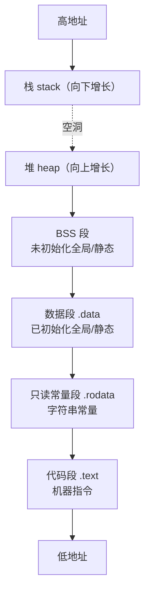

# 程序内存四区 & static 关键字（嵌入式必考 · 干货版）

> 以**代码和注释**为主，图表用于**比对**；所有英文缩写均标注中文。

## 0. 一句话总结

C 程序运行时的内存分为五区：**代码段（.text）、只读常量段（.rodata）、全局/静态区（.data + .bss）、栈（stack）、堆（heap）**。要能说清每个区**放什么、生命周期多长、由谁管理**，并吃透 **static（静态）的三种用法**。

## 1. 先跑代码看分区：demo1

```c
/*
 * demo1：打印不同类型变量的地址，观察各内存分区地址高低差异
 *
 * 观察点：
 *   1) 全局变量 g_val / 静态全局变量 g_static / 局部静态变量 s
 *      —— 地址相邻成组，说明它们都在"全局/静态区（.data 数据段）"
 *   2) 普通局部变量 a —— 在栈（stack）上，地址明显更高，
 *      且每次运行都可能变化（ASLR，地址空间布局随机化）
 *   3) 字符串常量 "hello" —— 在只读常量段（.rodata），与数据段相邻但不同区
 */
#include <stdio.h>

int g_val = 10;              /* 全局变量：数据段 .data（已初始化） */
static int g_static = 20;    /* 静态全局变量：数据段，仅本文件可见 */

int main(void)
{
    int a = 1;               /* 普通局部变量：栈，函数返回自动释放 */
    static int s = 2;        /* 局部静态变量：数据段，只初始化一次 */
    char *str = "hello";     /* str 指针在栈；"hello" 本体在只读常量段（.rodata） */

    printf("g_val: %p\n", &g_val);          /* %p 以十六进制打印地址 */
    printf("g_static: %p\n", &g_static);
    printf("a(stack): %p\n", &a);
    printf("s(static local): %p\n", &s);
    printf("str literal: %p\n", str);

    return 0;
}
```

**本机（MinGW-W64 / Windows x86-64）实测输出：**

```text
g_val: 00007FF6987E4010            <- 数据段（.data）
g_static: 00007FF6987E4014         <- 数据段（紧挨着）
a(stack): 000000BA035FFD94         <- 栈（stack）：地址最高、每次运行会变
s(static local): 00007FF6987E4018  <- 数据段（注意！不是栈）
str literal: 00007FF6987E5050      <- 只读常量段（.rodata）
```

**结论：** 全局变量和 static 变量（无论函数内外）都住在全局/静态区；普通局部变量在栈上；字符串常量在只读段。`s` 虽然是"局部"变量，加 static 后地址和数据段成组——这就是"static 局部变量在哪一区"的实证。

## 2. 内存分区比对表

| 分区 | 段名 | 存放内容 | 生命周期 | 谁管理 | 能否修改 |
|---|---|---|---|---|---|
| 代码段 | .text | 机器指令（函数代码） | 整个程序 | 编译器 + 操作系统 | 只读 |
| 只读常量段 | .rodata | 字符串常量、const（常量限定符）全局常量 | 整个程序 | 编译器 + 操作系统 | 只读，改了段错误 |
| 全局/静态区 | .data + .bss | 全局变量、static 变量 | 程序开始 → 结束 | 编译器 | 可读可写 |
| 栈 | stack | 局部变量、参数、返回地址 | 函数调用 → 返回 | 编译器（自动） | 可读可写 |
| 堆 | heap | malloc/free 动态分配的内存 | 申请 → 释放 | 程序员（手动） | 可读可写 |

> 常说的"四区" = 代码区 + 全局/静态区 + 栈 + 堆；只读常量段有的教材并入全局区，说清口径即可。`.data`（已初始化）与 `.bss`（未初始化）合称全局/静态区，`.bss` 启动时自动清零，所以**未初始化全局变量默认是 0**。

## 3. 地址空间布局（简化图）



**要点：** 栈向下增长、堆向上增长（两者相向）；地址数值因平台而异，相对高低关系一致。

## 4. 变量住哪里：代码看，表比

### 4.1 存储位置补充代码（局部 const）

```c
#include <stdio.h>

const int k_global = 100;   /* 全局 const → 只读常量段（.rodata） */
int main(void)
{
    const int k_local = 10; /* 局部 const → 仍在栈，仅编译器禁止赋值 */
    /* k_local = 20; */     /* 编译报错：不能对 const 变量赋值 */
    printf("%d %d\n", k_global, k_local);
    return 0;
}
```

### 4.2 变量对比表

| 变量 | 存储位置 | 生命周期 | 默认值 / 可否修改 |
|---|---|---|---|
| 普通局部变量 | 栈（stack） | 函数调用期间 | 垃圾值（未初始化） |
| static 局部变量 | 全局/静态区（.data/.bss） | 整个程序，只初始化一次 | 0 |
| 普通全局变量 | 全局/静态区 | 整个程序 | 0 |
| static 全局变量 | 全局/静态区 | 整个程序 | 0 |
| 字符串常量 | 只读常量段（.rodata） | 整个程序 | 不可修改 |
| const 全局常量 | 只读常量段（.rodata） | 整个程序 | 不可修改 |
| const 局部常量 | 栈（stack） | 函数调用期间 | 编译器禁止赋值 |

## 5. static 三种用法（代码为主，表做比对）

### 5.1 static 修饰局部变量 → 局部静态变量（跨调用保值）

```c
#include <stdio.h>

void counter(void)
{
    static int count = 0;   /* 只初始化一次；后续调用不再执行初始化 */
    count++;                /* 在上一次调用结果上累加 */
    printf("count = %d\n", count);
}

int main(void)
{
    int i;
    for (i = 0; i < 5; i++) {
        counter();          /* 输出 1 2 3 4 5；去掉 static 则一直输出 1 */
    }
    return 0;
}
```

| 维度 | 普通局部变量 | static 局部变量 |
|---|---|---|
| 存储位置 | 栈（stack） | 全局/静态区（.data/.bss） |
| 初始化次数 | 每次进函数 | 全程序一次 |
| 生命周期 | 函数调用期间 | 整个程序 |
| 作用域 | 函数内 | 函数内（不变） |
| 未初始化默认值 | 垃圾值 | 0 |

### 5.2 static 修饰全局变量 → 全局静态变量（内部链接）

```c
/* file_a.c */
static int hidden = 42;    /* 内部链接：其他文件 extern 都拿不到 */
int visible = 1;           /* 外部链接：其他文件 extern 后可访问 */

/* file_b.c */
extern int visible;        /* OK：普通全局变量可跨文件访问 */
/* extern int hidden; */   /* 链接错误：static 全局变量仅本源文件可见 */
```

| 维度 | 普通全局变量 | static 全局变量 |
|---|---|---|
| 存储位置 | 全局/静态区 | 全局/静态区（不变） |
| 生命周期 | 整个程序 | 整个程序（不变） |
| 链接属性 | 外部链接（external linkage） | 内部链接（internal linkage） |
| 可见范围 | 整个程序（extern 声明即可用） | 仅定义它的源文件 |
| 目的 | — | 防命名冲突、模块封装 |

### 5.3 static 修饰函数 → 静态函数（内部链接）

```c
/* module.c */
static int helper(int x)      /* 静态函数：仅本文件可见 */
{
    return x * 2;
}

int public_api(int x)         /* 普通函数：对外接口 */
{
    return helper(x) + 1;     /* 内部细节用 static 隐藏 */
}
```

### 5.4 三种用法总比对表

| 修饰对象 | 存储位置 | 生命周期 | 可见范围 | 主要目的 |
|---|---|---|---|---|
| 局部变量 | 全局/静态区 | 整个程序（初始化一次） | 函数内 | 跨调用保值 |
| 全局变量 | 全局/静态区 | 整个程序 | 本源文件 | 防冲突、封装 |
| 函数 | 代码段（.text） | 整个程序 | 本源文件 | 内部函数不外露 |

## 6. 只读段的坑：字符串常量不能改

```c
#include <stdio.h>

int main(void)
{
    char *s1 = "hello";   /* "hello" 在只读段（.rodata）；s1 是指向它的指针 */
    char s2[] = "hello";  /* s2 是栈上数组，是字面量的副本，可修改 */

    s2[0] = 'H';          /* 合法：改的是栈上的副本 */
    printf("s2 = %s\n", s2);

    /* s1[0] = 'H'; */    /* 非法：写只读段 → 段错误（Segmentation Fault） */
    return 0;
}
```

**口诀：** `char *s = "..."` 是借阅（只读）；`char s[] = "..."` 是抄写（可改）。

## 7. 堆（heap）vs 栈（stack）

### 7.1 堆的正确用法代码

```c
#include <stdlib.h>
#include <stdio.h>

int main(void)
{
    int *p = (int *)malloc(10 * sizeof(int));  /* 在堆上申请 40 字节 */
    if (p == NULL) {          /* 申请失败返回 NULL（空指针），必须判空 */
        printf("malloc failed\n");
        return 1;
    }
    p[0] = 100;
    printf("p[0] = %d, addr = %p\n", p[0], (void *)p);
    free(p);                  /* 手动释放堆内存 */
    p = NULL;                 /* 置空，防止野指针二次使用 */
    return 0;
}
```

### 7.2 对比表

| 维度 | 栈（stack） | 堆（heap） |
|---|---|---|
| 分配方式 | 编译器自动 | 程序员手动（malloc/free） |
| 增长方向 | 向下 | 向上 |
| 速度 | 快 | 慢（查空闲块） |
| 空间 | 小（可栈溢出） | 大（受物理内存限制） |
| 生命周期 | 函数返回自动释放 | 必须手动 free |
| 典型问题 | 栈溢出（递归过深/大数组） | 内存泄漏、野指针、double free |

## 8. 面试口述题（满分答案）

### Q1：static 全局变量和普通全局变量有什么区别？

> - **共同点**：都存于全局/静态区，生命周期都是整个程序；
> - **区别在链接属性**：普通全局变量是外部链接（external linkage），其他源文件 `extern` 声明即可访问；static 全局变量是内部链接（internal linkage），仅定义它的源文件可访问；
> - **目的**：防止多文件命名冲突，实现模块级封装；
> - **加分点**：static 只改"可见性"，不改变存储位置和生命周期。

### Q2：static 局部变量存放在哪个区？

> - 存放在**全局/静态区（数据段 .data/.bss）**，不是栈；
> - 只初始化一次，存活到程序结束；
> - 作用域仍限于函数内；
> - **加分点**：demo1 实测——它的地址与全局变量成组，不与栈变量在一起。

## 9. 嵌入式视角（重点）

```c
static volatile unsigned int tick = 0;
/* 组合含义：
   static（静态）   = 本文件可见，模块封装
   volatile（易失） = 禁止编译器优化到寄存器，防止中断修改被"优化掉" */

void SysTick_Handler(void)   /* ISR：中断服务函数（Interrupt Service Routine） */
{
    tick++;                  /* 1ms 滴答定时器中断 */
}

unsigned int get_tick(void)
{
    return tick;             /* 主循环经接口函数读取 */
}
```

**要点：**

- MCU（微控制器）的 SRAM（静态随机存取存储器）只有几十~几百 KB，栈和堆默认仅几 KB，滥用会复位/死机；
- 嵌入式规范普遍**禁用/少用 malloc**（堆碎片化、分配不确定），优先 static 静态分配，大小编译期确定；
- 模块化：驱动 .c 文件内部状态、缓冲区用 static 隐藏，只暴露接口函数；
- static 管"可见范围/生命周期"，volatile 管"防优化"，两者不同、常组合使用。

## 10. 常见误区速查表

| 误区 | 真相 |
|---|---|
| "static 局部变量在栈上" | 错！在全局/静态区（.data/.bss） |
| "static 全局变量生命周期更短" | 错！生命周期不变，变的只是可见性 |
| "局部 const 变量在只读段" | 错！局部 const 在栈，只是禁止赋值 |
| "字符串常量能改" | 错！只读段（.rodata），改了未定义行为/段错误 |
| "malloc 忘了 free 没事" | 内存泄漏，长期运行内存耗尽（嵌入式更致命） |
| "未初始化局部变量默认是 0" | 错！栈上局部变量是垃圾值；只有全局/static 是 0 |

## 11. Demo 速览

| Demo | 验证内容 | 关键输出 |
|---|---|---|
| demo1_memory_addresses.c | 各分区地址高低 | 全局/static 成组；栈地址最高且每次变 |
| demo2_static_local_var.c | static 跨调用保值 | count = 1 → 5（去 static 恒为 1） |

```bash
gcc demo1_memory_addresses.c -o demo1 && ./demo1
gcc demo2_static_local_var.c -o demo2 && ./demo2
```
