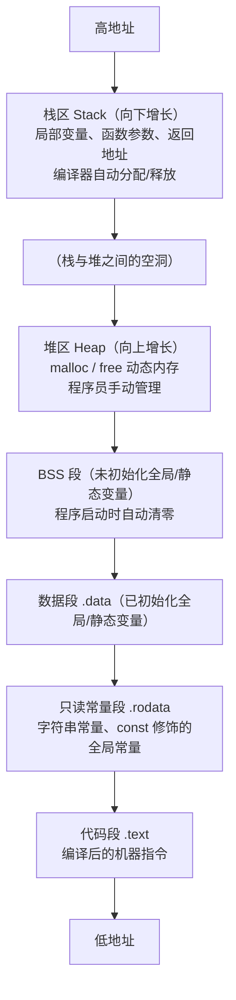
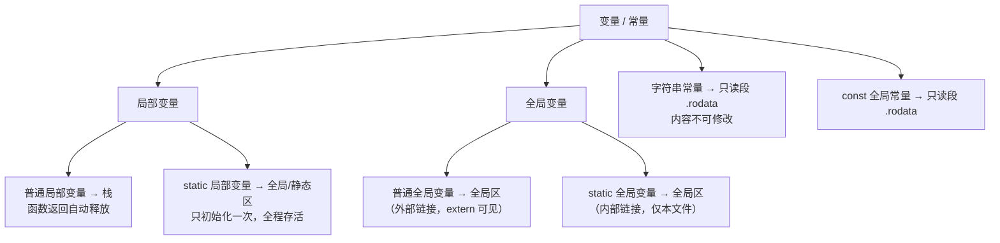
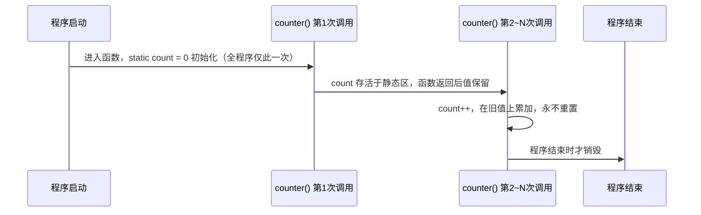

# 程序内存四区 & static 关键字 —— 干货详解（嵌入式必考）

## 0. 一句话总结

> C 程序跑起来后，内存被分成若干区域：**代码段、只读常量段、全局/静态区、栈、堆**。你要能说清：**每个区放什么、生命周期多长、由谁管理**；还要吃透 **static 的三种用法**——这是嵌入式面试的高频考点。

## 1. 程序在内存中长什么样（总览图）



**读图要点（面试直接背）：**

- 从高地址到低地址依次：**栈 → 堆 → BSS → .data → .rodata → .text**
- 栈**向下增长**（往低地址长），堆**向上增长**（往高地址长），两者相向而行
- 栈和堆的增长方向是面试最爱问的细节
- 具体数值因平台/编译器而异（Windows、Linux、MCU 各不相同），但**相对高低关系**基本一致

## 2. 内存分区总表（第一题必答）

| 分区 | 段名 | 存放内容 | 生命周期 | 谁管理 | 能否修改 |
|---|---|---|---|---|---|
| 代码段 | .text | 机器指令（函数代码） | 整个程序 | 编译器 + OS | 只读 |
| 只读常量段 | .rodata | 字符串常量、const 全局常量 | 整个程序 | 编译器 + OS | 只读（改了段错误） |
| 全局/静态区 | .data + .bss | 全局变量、static 变量 | 程序开始 → 结束 | 编译器 | 可读可写 |
| 栈 | stack | 局部变量、参数、返回地址 | 函数调用 → 返回 | 编译器 | 可读可写 |
| 堆 | heap | malloc/new 的动态内存 | 申请 → 释放 | 程序员 | 可读可写 |

**两个易错点：**

1. 常说的"四区" = 代码区 + 全局/静态区 + 栈 + 堆；只读常量段有的教材并入全局区、有的单列，**说清楚即可，考官不会纠结口径**
2. `.data`（已初始化）和 `.bss`（未初始化）都属于全局/静态区：bss 在启动时由 CRT 清零，所以**未初始化的全局变量默认是 0**

## 3. 变量的"家"在哪里（分类树）



### 用代码验证（demo1 实测）

demo1 打印各类地址，本机（MinGW-W64 x86-64 / Windows）实测输出：

```text
g_val: 00007FF6987E4010            <- 数据段
g_static: 00007FF6987E4014         <- 数据段（紧挨着）
a(stack): 000000BA035FFD94         <- 栈：地址明显更高、每次运行会变（ASLR）
s(static local): 00007FF6987E4018  <- 数据段（注意！不是栈）
str literal: 00007FF6987E5050      <- 只读常量段（与数据段相邻但不同区）
```

**你能从中读出什么（面试加分点）：**

- `g_val`、`g_static`、`s` 三个地址**相邻成组** → 全局变量和 static 变量（不管它在函数内还是函数外）统统住在全局/静态区
- `a` 是唯一明显不同的 → 普通局部变量在栈上，地址高、且随 ASLR 每次运行变化
- `str` 本身是栈上的指针变量，但 `"hello"` 的本体在只读段
- 注意 `s`：它虽然是函数内的"局部"变量，加了 static 后**住址就搬去了数据段**——这就是"static 局部变量在哪个区"的实锤答案

## 4. static 的三种用法（核心考点，背到滚瓜烂熟）

### 4.1 static 修饰局部变量 → 局部静态变量

**作用一句话：** 变量"搬家"到全局/静态区，只初始化一次，跨调用保持值；作用域不变（仍限函数内）。

```c
#include <stdio.h>

void counter(void)
{
    static int count = 0;   /* 只初始化一次；之后的调用不再重新执行初始化 */
    count++;                /* 在上一轮的基础上累加 */
    printf("count = %d\n", count);
}

int main(void)
{
    int i;
    for (i = 0; i < 5; i++) {
        counter();          /* 输出 1 2 3 4 5；若去掉 static 会一直输出 1 */
    }
    return 0;
}
```

生命周期示意：



**对比：**

| | 普通局部变量 | static 局部变量 |
|---|---|---|
| 存储位置 | 栈 | 全局/静态区 |
| 初始化次数 | 每次进函数 | 全程序一次 |
| 生命周期 | 函数调用期间 | 整个程序 |
| 作用域 | 函数内 | 函数内（不变） |
| 未初始化时的值 | 垃圾值 | 0 |

### 4.2 static 修饰全局变量 → 全局静态变量

**作用一句话：** 全局变量仍住全局区、生命周期不变，但**链接属性从"外部"变"内部"**——只有定义它的源文件能访问。

```c
/* file_a.c */
static int hidden = 42;    /* 内部链接：file_b.c 想 extern 都拿不到 */
int visible = 1;           /* 外部链接：其他文件 extern 后可访问 */

/* file_b.c */
extern int visible;        /* OK：能拿到 file_a.c 的普通全局变量 */
/* extern int hidden; */   /* 链接错误：static 全局变量对本文件不可见 */
```

**为什么这样设计？**

- 多文件项目里，每个模块都可以定义自己的"私有全局状态"，不怕重名
- 相当于 C 语言里的"模块私有成员"，实现文件级封装
- 嵌入式里：外设模块的状态缓存、驱动句柄等常用 static 全局保护起来

### 4.3 static 修饰函数 → 静态函数

**作用一句话：** 函数只在当前源文件内可见（内部链接），外部文件无法调用。

```c
/* module.c */
static int helper(int x)      /* 静态函数：模块内部工具函数，外部看不到 */
{
    return x * 2;
}

int public_api(int x)         /* 普通函数：对外暴露的接口 */
{
    return helper(x) + 1;     /* 内部实现细节用 static 藏起来 */
}
```

**与 static 全局变量逻辑完全相同：** 都是把"可见范围"从整个程序收缩到本源文件。

### 4.4 三种用法速查

| 修饰对象 | 存储位置 | 生命周期 | 作用域/可见性 | 主要目的 |
|---|---|---|---|---|
| 局部变量 | 全局/静态区 | 整个程序（只初始化一次） | 函数内 | 跨调用保持值 |
| 全局变量 | 全局/静态区 | 整个程序 | 本源文件（内部链接） | 防命名冲突、模块封装 |
| 函数 | 代码段 | 整个程序 | 本源文件（内部链接） | 内部工具函数不外露 |

## 5. 只读段的坑：字符串常量不能改

```c
#include <stdio.h>

int main(void)
{
    char *s1 = "hello";   /* "hello" 本体在只读段；s1 是指向它的指针 */
    char s2[] = "hello";  /* s2 是栈上数组，内容是字面量的"副本"，可修改 */

    s2[0] = 'H';          /* 合法：改的是栈上的副本 */
    printf("s2 = %s\n", s2);

    /* s1[0] = 'H'; */    /* 非法：写只读段 → 段错误 / 未定义行为 */

    return 0;
}
```

**记忆口诀：** `char *s = "..."` 是"借阅"（只读）；`char s[] = "..."` 是"抄写"（可改）。

## 6. 堆与栈：一对相爱相杀的内存兄弟

| 维度 | 栈（stack） | 堆（heap） |
|---|---|---|
| 分配方式 | 编译器自动（函数调用压栈） | 程序员手动（malloc/free） |
| 增长方向 | 向下（高 → 低地址） | 向上（低 → 高地址） |
| 速度 | 快（一条指令） | 慢（查找空闲块） |
| 空间 | 小（默认几 MB，可溢出） | 大（受物理内存限制） |
| 生命周期 | 函数返回自动释放 | 释放必须自己调用 free |
| 典型问题 | 栈溢出（递归过深/大局部数组） | 内存泄漏、野指针、double free |

```c
/* 堆：申请 → 使用 → 释放 必须成对出现 */
#include <stdlib.h>
#include <stdio.h>

int main(void)
{
    int *p = (int *)malloc(10 * sizeof(int));  /* 在堆上申请 40 字节 */
    if (p == NULL) {          /* malloc 可能失败，务必判空！ */
        printf("malloc failed\n");
        return 1;
    }

    p[0] = 100;
    printf("p[0] = %d, addr = %p\n", p[0], (void *)p);

    free(p);                  /* 释放堆内存 */
    p = NULL;                 /* 置空，防止"野指针"二次使用 */
    return 0;
}
```

**栈溢出演示（别真的跑，会崩）：**

```c
void recurse(int n)
{
    char big[1024 * 1024];    /* 每次递归压栈 1MB */
    printf("n = %d\n", n);
    recurse(n + 1);           /* 无终止条件 → 栈耗尽 → Stack Overflow */
}
```

**嵌入式提醒：** MCU 的栈和堆大小在链接脚本/启动文件中手动指定（如 STM32 默认栈 0x400、堆 0x200），堆栈交界处碰撞会"悄悄"踩坏数据——所以嵌入式里**尽量少用堆、多用 static 和全局变量**，这也是为什么 static 是嵌入式必考。

## 7. 面试口述题（满分答案）

### Q1：static 全局变量和普通全局变量有什么区别？

> 分两层答，先共同点后区别：
>
> - **共同点**：两者都存储在全局/静态区（数据段），生命周期都是整个程序运行期间；
> - **区别在链接属性**：普通全局变量是**外部链接（external linkage）**，其他源文件用 `extern` 声明后就能访问；而 static 全局变量是**内部链接（internal linkage）**，作用域被限制在定义它的源文件内，其他文件无法访问；
> - **目的**：防止多文件项目中的命名冲突，实现模块级封装；
> - **加分点**：static 全局变量**不改变存储位置和生命周期**，只改变"可见性"。很多人以为它"作用域小了就不占内存"，错——它一样占满整个程序生命周期。

### Q2：static 局部变量存放在哪个区？

> - 存放在**全局/静态区（数据段）**，**不是栈**；
> - 只在第一次进入函数时初始化一次，之后一直存活到程序结束；
> - 作用域仍然局限于函数内部，外部无法访问；
> - **加分点**：可用 demo1 实测证明——局部静态变量 `s` 的地址和全局变量相邻成组，而不是和栈变量在一起。

## 8. 嵌入式视角（为什么这课对嵌入式特别重要）

- **MCU 内存小**：SRAM 通常只有几十~几百 KB，栈和堆各只有几 KB，分配多了直接复位/死机；
- **静态分配优先**：嵌入式规范普遍要求**禁用/少用 malloc**（不确定的堆分配 + 碎片化），改用 static 变量，大小在编译期就确定；
- **static + volatile 经典组合**：ISR（中断服务函数）与主循环共享的变量，通常声明为 `static volatile`：

```c
static volatile unsigned int tick = 0;   /* 本文件可见 + 禁止编译器优化 + 跨中断共享 */

void SysTick_Handler(void)     /* 1ms 滴答定时器中断（伪代码） */
{
    tick++;
}

unsigned int get_tick(void)    /* 主循环通过接口函数读取，不直接碰 tick */
{
    return tick;
}
```

- **模块化编程**：每个驱动文件（.c）内部的状态、缓冲区、回调用 static 藏起来，只暴露必要的接口函数——这是嵌入式工程的基本规范；
- **与 volatile 区分**：static 管"可见范围/生命周期"，volatile 管"编译器不要优化到寄存器"，两者用途完全不同，别混。

## 9. 常见误区速查（踩坑清单）

| 误区 | 真相 |
|---|---|
| "static 局部变量在栈上" | 错！在全局/静态区（数据段） |
| "static 全局变量生命周期更短" | 错！生命周期不变，变的只是可见性（链接属性） |
| "局部 const 变量在只读段" | 错！局部 const 仍在栈，只是编译器禁止赋值 |
| "字符串常量能改" | 错！在只读段，修改是未定义行为/段错误 |
| "malloc 一次忘 free 没事" | 内存泄漏，长期运行内存耗尽（嵌入式更致命） |
| "未初始化的局部变量默认是 0" | 错！栈上局部变量是垃圾值；只有全局/static 默认是 0 |

## 10. Demo 速览

| Demo | 验证什么 | 关键输出 |
|---|---|---|
| demo1_memory_addresses.c | 各分区地址高低 | 全局/static 成组；栈地址最高且每次运行变化 |
| demo2_static_local_var.c | static 跨调用保值 | count = 1 → 5（去 static 则恒为 1） |

```bash
gcc demo1_memory_addresses.c -o demo1 && ./demo1
gcc demo2_static_local_var.c -o demo2 && ./demo2
```
